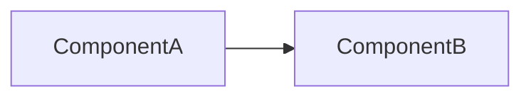
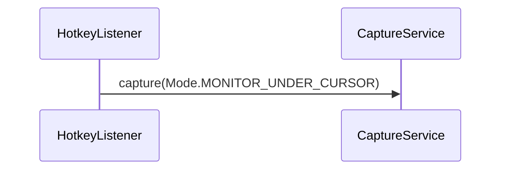

# TDD-NNN: <Название фичи / подсистемы>

| Поле | Значение |
|---|---|
| Статус | Draft / Review / Approved / Implemented / Superseded |
| Автор | Tech |
| Дата | YYYY-MM-DD |
| Входные артефакты | REQ-…, US-…, RES-… |
| ADR | ADR-… |
| Задачи | TASK-…–TASK-… |

## 1. Цель и рамки

- **Цель:** <что технически реализуется этим дизайном, 2–4 предложения>.
- **Входит:** <…>
- **Не входит:** <…, со ссылкой на причину: Won't в REQ, другой TDD>

## 2. Трассировка требований

| Требование / AC | Суть (кратко) | Компонент(ы) | Задача(и) | Как проверяется |
|---|---|---|---|---|
| REQ-…  | <…> | `<ClassName>` | TASK-… | unit-тест / ручная проверка / замер |

> Каждое Must/Should требование из входных артефактов должно быть в таблице. Could — либо в таблице, либо в «Не входит» с причиной.

## 3. Принятые технические решения

| Вопрос | Решение | Альтернативы | Обоснование / ADR |
|---|---|---|---|
| <…> | <…> | <…> | ADR-… / <кратко> |

## 4. Архитектура

### 4.1. Компоненты



| Компонент | Пакет / файл | Ответственность | Зависит от | Поток |
|---|---|---|---|---|
| `<ClassName>` | `<package>` / `src/main/kotlin/.../<File>.kt` | <…> | <…> | <EDT / IO / любой> |

### 4.2. Правила зависимостей

<Какие компоненты знают друг о друге, где проходят границы платформенного кода и доменной логики.>

## 5. Контракты

> Точные Kotlin-сигнатуры публичных/internal API между компонентами. Без реализаций.

```kotlin
package <base>.<module>

/** <Назначение. Поток вызова. Потокобезопасность.> */
internal interface <Name> {
    /**
     * <Что делает.>
     * @param <p> <смысл, допустимые значения, единицы измерения>
     * @return <смысл; что при ошибке>
     */
    fun <method>(<p>: <Type>): <ResultType>
}

internal data class <Value>(
    val <field>: <Type>, // <единицы, диапазон>
)

internal sealed interface <Name>Result {
    data class Success(val <…>: <…>) : <Name>Result
    data class Failure(val reason: <Reason>) : <Name>Result
}
```

## 6. Сценарии и потоки данных

### 6.1. <Сценарий, например «Захват монитора под курсором»>



Пошагово:
1. <…> (поток: <…>)
2. <…>

## 7. Многопоточность и состояние

- Модель потоков: <…>
- Разделяемое состояние и его защита: <…>
- Жизненный цикл (запуск, остановка, освобождение ресурсов): <…>

### 7.1. Состояния (если есть)

| Состояние | Событие | Новое состояние | Действие |
|---|---|---|---|
| `Idle` | <…> | `<…>` | <…> |

## 8. Алгоритмы и формулы

<Псевдокод / формулы. Обязательно числовой пример на конкретных входных данных.>

**Пример:** <входные данные> → <промежуточные значения> → <результат>.

## 9. Обработка ошибок

| Ситуация | Где обнаруживается | Поведение системы | Лог (уровень, текст) | Что видит пользователь |
|---|---|---|---|---|
| <…> | `<ClassName>` | <…> | `WARN "<…>"` | `"<точный текст>"` |

## 10. Конфигурация, константы и тексты UI

| Имя | Тип | Значение | Где объявлена | Требование |
|---|---|---|---|---|
| `<CONST_NAME>` | `<Type>` | `<value>` | `<File.kt>` | REQ-… |

| Ключ / место | Точный текст |
|---|---|
| <уведомление об успехе> | `"<…>"` |

## 11. Хранение данных и форматы

<Файлы, ключи настроек, форматы, значения по умолчанию, миграции. Н/П — если не применимо.>

## 12. Логирование

<Какие события логируются, на каком уровне; что логировать запрещено.>

## 13. Производительность и ресурсы

| NFR | Как достигается | Как измеряется |
|---|---|---|
| REQ-….N1 | <…> | <…> |

## 14. Стратегия тестирования

| Уровень | Что проверяется | Инструменты | Задачи |
|---|---|---|---|
| Unit | <…> | <…> | TASK-… |
| Интеграционный | <…> | <…> | TASK-… |
| Ручной | <…> | Чек-лист в задаче | TASK-… |

## 15. Риски

| Риск | Вероятность | Влияние | Митигация |
|---|---|---|---|
| <…> | Низкая / Средняя / Высокая | <…> | <…> |

## 16. План задач

| Порядок | Задача | Название | Зависит от | Оценка |
|---|---|---|---|---|
| 1 | TASK-… | <…> | — | S / M / L |

## 17. Допущения и открытые вопросы

- **Допущение:** <…>
- [ ] <Вопрос> — <кому: пользователю / Analyst>; <на что влияет>
